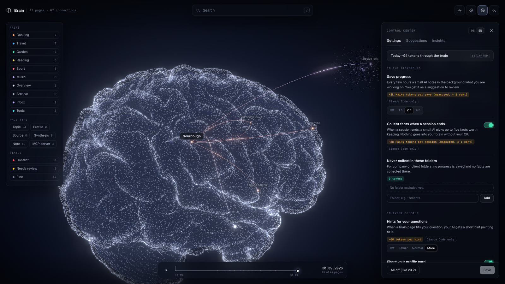
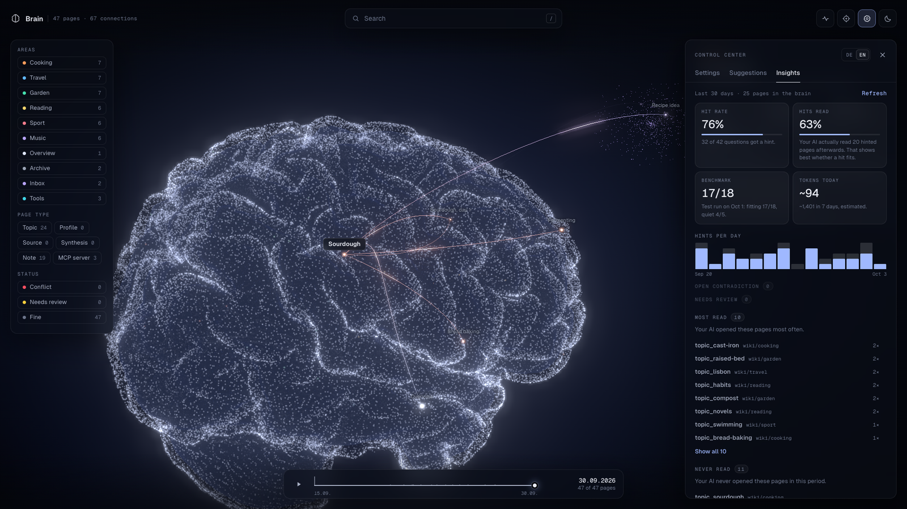
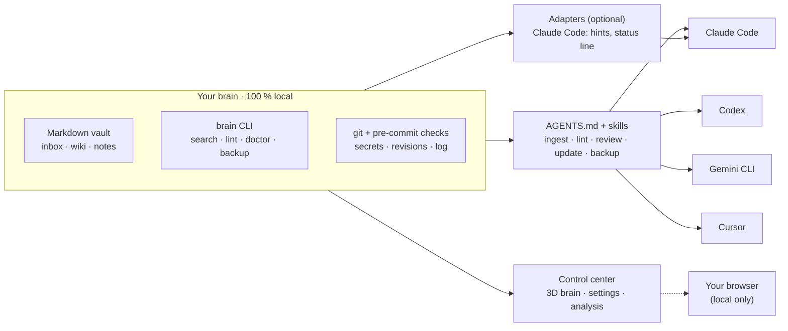
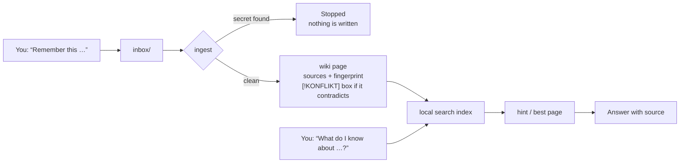
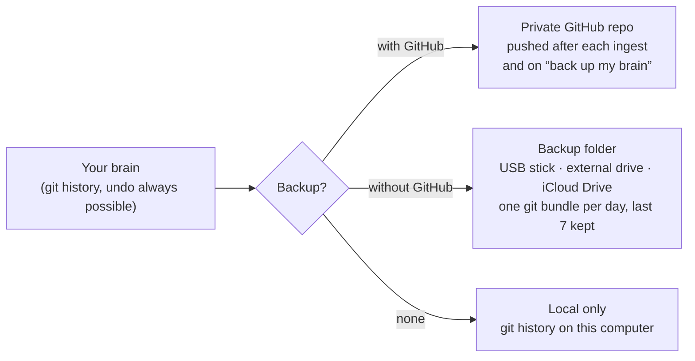

<p align="center">
  <picture>
    <source media="(prefers-color-scheme: dark)" srcset="assets/logo-dark.svg">
    <source media="(prefers-color-scheme: light)" srcset="assets/logo.svg">
    
  </picture>
</p>

<p align="center"><b>The second brain your AI can trust — no contradictions, every fact sourced, near-zero tokens.</b></p>

<p align="center">
  <a href="https://github.com/fbrogno/second-brain-kit/actions/workflows/test.yml"></a>
  <a href="LICENSE"></a>
  <a href="CHANGELOG.md"></a>
  
  
</p>

Your AI apps forget everything between chats, and when they do remember, you can't tell where a fact
came from. This kit sets up a folder of plain Markdown files on your own computer that your AI reads
before it answers and writes to when you say "remember this". Every page names its sources, contradictions
stay visible instead of being quietly overwritten, and nothing leaves your machine unless you want a backup.

| | Typical second brain | This one |
|---|---|---|
| **Who it's for** | People who enjoy building systems — plugins, templates, folder rules. | Anyone who can type a sentence to their AI. No terminal, no config file. |
| **Contradictions** | The same thing sits in several notes with different numbers — nobody notices. | Found on import and on every ingest; both claims stay side by side until you decide. |
| **Where facts come from** | Hard to tell after a few months. | Every page lists its sources with a fingerprint; a changed source flags the page. |
| **Context for the AI** | Whole folders pasted in, or a tool server whose descriptions cost tokens in every chat. | One short hint with the best page; the AI reads only that page. |
| **Cost** | Paid app or plugin, plus tokens for everything the AI reads. | Free (MIT). Everything the kit does itself costs 0 tokens; every AI-based extra is off until you switch it on, with its cost shown. |
| **Upkeep** | Manual gardening — or none. | Checks for drift, decay and conflicts; new knowledge arrives as suggestions you accept with one click. |
| **Quality measured** | Never. | Analysis tab: how often hints hit, whether the AI actually read them, pages nobody reads, gaps. |

> **Status:** v0.3 — an early public release, now with a control center inside the 3D brain, an importer
> for old brains and an opt-in background harvest. It works and is tested on all three systems, but expect
> rough edges. Feedback is very welcome.

## Quick start — for everyone

Open your AI app, paste this sentence, and send it:

```text
Set up the second brain from github.com/fbrogno/second-brain-kit for me.
```

Auf Deutsch:

```text
Richte mir das Second Brain von github.com/fbrogno/second-brain-kit ein.
```

Your AI will ask you at most two things — where the brain should live (suggestion: `Documents/Brain`)
and whether you also want an online backup at GitHub (yes / no / later). Everything else it works out
by itself. You never have to open a terminal. It takes about 10–20 minutes, most of it a one-time
download for the search (~300 MB, announced before it starts).

When it's done, you only need four sentences:

- *"Remember this: …"* — saves something.
- *"What do I know about …?"* — searches your brain and answers with the source.
- *"Show me my brain."* — opens your brain in 3D, with the control center.
- *"Update my brain."* — installs a new version when one is out.

Coming from Obsidian, Notion or Logseq? *"Import my old brain from <folder>."*

**Which app?** Your AI needs to be able to run commands and read files on your computer. That means
**Claude Code** (in the terminal, or in the **Code** or **Cowork** tab of the Claude Desktop app — both
need a paid plan), the **Codex** app or CLI, **Gemini CLI**, or **Cursor**. The regular chat in Claude
Desktop or in a browser can't install anything — use the Code or Cowork tab or the Codex app instead.

## See your brain in 3D

<p align="center"></p>

Say *"show me my brain"* to your AI (or run `node .tools/brain.mjs zeig` in your brain folder) and it opens in the browser:
an anatomically shaped brain with every page as a point of light, grouped by your areas and connected by
their links. Search flies to the best match, a click opens the page with its sources, conflicts and pages
that need review light up, and a timeline replays how your brain grew. It runs on a small service on your
own computer (only `127.0.0.1`) — no internet, no account. The picture above shows made-up example pages.

## Control center

The 3D brain is also where you steer it. Everything here runs locally and costs 0 tokens.

<p align="center"></p>

- **Settings** — the gear at the top right. Every switch says in one sentence what happens, shows its cost
  ("0 tokens" or an estimate) and whether it only works in Claude Code. One click on "all off" brings back the
  v0.2 behaviour. Saved only to the `automatik` section of `brain.config.json`; if your AI changed the file
  at the same moment, you get "changed elsewhere — reload" instead of a silent overwrite. Without the view:
  `brain einstellungen key=value` (folder lists: separate with `;`, add one with
  `ernteNichtIn+=<folder>`, or give a JSON list — folder names may contain commas).
- **Suggestions** — new knowledge from the background harvest (below) waits here. *Accept* moves it to the
  inbox, where the normal ingest picks it up; *discard* moves it to the archive. Nothing is deleted, nothing
  enters the wiki without your click.
- **Analysis** — how often a hint was found, whether the AI really read the page afterwards, the latest
  benchmark run, pages nobody reads, pages without links, open conflicts, and a token estimate for today and
  the last 7 days. Also as `brain analyse`.
- **MCP area** — the MCP servers your AI apps know (Claude Code, Claude Desktop, Cursor, Codex, Gemini CLI)
  and the connectors they actually use, as their own region of the brain, linked to your pages about them.
  Only names are read — never commands, keys, URLs or headers.
- **Live glow** — while you work, the pages and tools your AI reads light up for a few seconds (Claude Code).

The service only answers on `127.0.0.1`, needs a random key that changes on every start, and refuses other
websites in the same browser. If it can't start, the view opens read-only from a file, as in v0.2. The
interface speaks English and German.

## Import old brains

*"Import my old brain from <folder>"* (or `brain import <folder|zip>`) brings in an Obsidian vault, a Notion
export (zip), a Logseq graph or any folder with `.md`, `.txt` and `.pdf` files. The source is only read, never
changed; the notes are copied to `inbox/_import/<name>/`. Before anything enters the wiki, a local check
(0 tokens) writes a report:

- **exact duplicates** — skipped, also when the brain already has the same text;
- **near duplicates** (80 % alike) — grouped as "same thing, several versions";
- **contradictions** — the same topic with different numbers, dates, prices, versions or yes/no answers,
  side by side with the newer one marked, also checked against your existing wiki;
- **overlaps** — notes that extend a page you already have;
- **a plan in packages** with a token estimate for each.

Imported Markdown notes (`.md`) can be found by search right away, marked "unchecked (import)"; `.txt` and
PDF files wait in the import folder. Your AI works them into the
wiki one package at a time, only after you say yes — one page per group of near duplicates, and every
contradiction becomes a conflict box with both sources. It never picks a winner for you.

## Background harvest

Opt-in, Claude Code only, off by default. Two switches: *"save the state every 1/2/4 hours"* and *"collect
facts when a session ends"*. A separate, small run of Claude Haiku reads the end of the session's
transcript (at most 24,000 characters) — outside your session, so it uses none of your conversation's
context. It returns at most five short facts or one status note, which land as **suggestions** in the
control center.

- **Never secrets:** lines that look like passwords, keys or connection strings are dropped before Haiku
  sees the text, and the result is checked again before it is saved.
- **Excluded folders:** list folders where it must never run (for example a client or company folder) under
  "never harvest in these folders". Every suggestion names the folder it came from.
- Short sessions (under 5 prompts) are skipped, only one run at a time, and errors stay quietly in the log.
- **Lean run:** Haiku gets a short instruction of its own instead of the Claude Code system prompt, no tools,
  no MCP servers and no saved session. The measured tokens of each run are written to `.logs/ernte.log`
  (`tokEin`/`tokAus`) and feed the analysis tab.
- **Once per session part:** if a session is compacted and later ends, the second run only reads what came
  after the first one. If Claude Code closes before the run is done (possible on Windows), the next session
  start finishes it.

## Token costs

Out of the box, the kit itself puts **0 tokens** into your conversations except where noted below; every
feature that calls an AI on its own is off until you switch it on. Estimates are shown in the settings and,
summed up, in the analysis tab.

| Switch | Default | Cost |
|---|---|---|
| Control center, analysis, MCP area, suggestions, import check | always | 0 tokens — plain Node on your computer |
| Live glow (`liveAufleuchten`, Claude Code) | on | 0 tokens — the hook only writes a local log |
| Remember searches without results (`luecken`) | off | 0 tokens |
| Hints before a prompt (`hinweise`, Claude Code) | normal | ~60 tokens per hint, only when a page matches |
| Project page line at session start (`projektAutomatik`, Claude Code) | on | ~30 tokens per session, only when a page matches |
| "N new suggestions" line at session start | on | ~15 tokens, only when there are some |
| Update notice (`updateHinweis`) | on | ~20 tokens per new version |
| "Me" card `wiki/ich.md` at session start (`ichKarte`) | off | ~250 tokens per session |
| Save the state every X hours (`staendeIntervallStunden`, Claude Code) | off | one Haiku run per save (measured: ~8k input, ~0.8k output tokens, about 1 cent), outside the session |
| Collect facts at session end (`ernteSitzungsende`, Claude Code) | off | one Haiku run per session (measured: ~8k input, ~0.8k output tokens, about 1 cent), outside the session |
| Working an import package into the wiki | asked per package | estimate shown per package before you say yes |


## Quick start — for developers

One line, no admin rights, no git needed (it fetches a private copy of Node.js into `~/.brain-kit/`):

**macOS / Linux**
```sh
curl -fsSL https://raw.githubusercontent.com/fbrogno/second-brain-kit/main/bootstrap.sh | bash
```

**Windows (PowerShell)**
```powershell
irm https://raw.githubusercontent.com/fbrogno/second-brain-kit/main/bootstrap.ps1 | iex
```

Defaults: brain in `~/Documents/Brain`, no online backup. To choose, pass `--ziel "<path>" --backup github`
(PowerShell: save the script first, then `-Ziel` / `-Backup` — see [INSTALL.md](INSTALL.md#step-2--get-the-kit-and-install)).

**From a clone** (Node.js 20 or newer):
```sh
git clone https://github.com/fbrogno/second-brain-kit.git
cd second-brain-kit
node install.mjs ~/Documents/Brain --agent claude-code --profil leicht --backup keins
node ~/Documents/Brain/.tools/brain.mjs doctor
```

[INSTALL.md](INSTALL.md) is the step-by-step script your AI follows; every step has a check command and the
expected output. Options: `--agent claude-code|codex|keiner`, `--sprache de|en`, `--profil minimal|leicht|voll`,
`--backup keins|github|ordner:<path>`.

## How it works

### One core, several ways in

The brain itself is a folder with Markdown files, a small command-line tool and a git history. Your AI
tools reach it through plain instructions (`AGENTS.md` plus skills), optional adapters for extra comfort,
and — maybe later — an optional local MCP server.



Hooks and adapters are comfort, never a requirement: every function also works through `AGENTS.md` and the
skills, and the hard safety checks run in git itself, so they apply no matter which AI is writing.

### The life of a note



1. A new note lands in `inbox/`.
2. **Ingest** first runs the secrets check. If it finds anything that looks like a password or key, it stops
   and writes nothing.
3. The AI works the note into the wiki. Each page lists its sources with a fingerprint (hash) of the exact
   version it was written from. If the new note contradicts an existing page, both claims stay side by side
   in a conflict box until you decide.
4. A git commit records the change. The pre-commit hook blocks secrets (in every staged text file, whatever
   its name), page edits without a new revision number, and any rewrite of the ingest log's history. It
   finds the kit's own Node copy even when it isn't on your PATH, and if it can't run its checks at all, it
   stops the commit instead of letting it through.
5. When you ask something, the AI searches locally, reads the one best page and tells you where the answer
   came from. In Claude Code a hint with the best match appears before each prompt automatically.

### Backup — your choice



You can switch any time: *"Set up an online backup"* or *"Set up a backup folder"*. Restoring is one
sentence too: *"Restore my brain from the backup."* A `.git` folder is never placed inside a sync folder —
cloud sync can corrupt it, which is why the folder option uses single bundle files. The backup runs after
each ingest and whenever you say *"Back up my brain"*; with the Claude Code adapter it also runs
automatically at the start of each session (currently only there).

## Features

| | What it means for you | How the kit does it |
|---|---|---|
| **Correct** | Answers come with a source you can check. | Every wiki page lists its sources with a fingerprint; when a source changes, the page is flagged *needs review* (`PRÜFBEDÜRFTIG`). |
| | Contradictions are never silently "fixed". | A `[!KONFLIKT]` box keeps both claims and both sources until you decide. |
| | Old knowledge doesn't pass as fresh. | `lint` finds drift, decay, orphans and open conflicts; `review` (about every 30 days) re-checks only what changed. |
| | Passwords and keys stay out. | Secrets check before every ingest and again in the git pre-commit hook — for every AI, with or without hooks. |
| **Complete** | Saving is one sentence. | "Remember this …" → inbox → ingest; sources can be notes, files or text. |
| | Nothing gets lost. | Full git history, a log of every ingest (`_log.md`), backup to GitHub or a folder. |
| | Mistakes in hints get fixed. | `feedback` records a wrong or missing hint in one line, so search can be tuned. |
| **Always in context** | The AI looks in your brain first. | `AGENTS.md` tells every AI tool to search before answering and read only the best page. |
| | Fast, local search on any machine. | Three profiles: `minimal` (plain text, no download), `leicht` (local embeddings, ~300 MB), `voll` (adds a reranker, ~2 GB, opt-in). The installer picks one once, based on what your computer can run; `brain doctor` checks it later and warns if it doesn't fit. |
| | Hints without asking. | Claude Code adapter: a hint with the best page before each prompt, a status line and a short start-up summary. |
| | Pick up where you left off. | `handoff` saves the state of a piece of work for the next session. |
| | See what you know at a glance. | `brain zeig` builds a 3D view of all pages and links — search, sources, conflicts and a timeline. |
| | Steer it without config files. | The control center: settings with a cost label per switch, suggestions to accept or discard, the MCP tools your apps use. |
| | Bring your old notes along. | `brain import` copies Obsidian, Notion, Logseq or plain folders and reports duplicates and contradictions before anything enters the wiki. |
| | Know whether it works. | `brain analyse`: hint hit rate, pages actually read, never-read pages, gaps, token estimate. |

## Privacy

- **Everything runs on your computer.** Notes, wiki, search index and search models stay local. There is no
  account, no server and no telemetry.
- **Your AI app is the only thing that sees your notes** — the same app you already chat with. What it sends
  to its provider depends on that app, not on this kit.
- **Network use, completely listed:**
  - **Setup** downloads what it needs once: Node.js (only if yours is missing or too old), the kit itself,
    the search engine (an npm package, ~300 MB with its parts) and, on Windows, a portable git.
  - **The better search downloads its language models from the internet on first use** (one time; after
    that it works offline). Profile `minimal` downloads nothing.
  - **The backup you chose** (your own private GitHub repo) — nothing if you picked no backup or a folder.
  - **A version check** against the public release list, at most once a day, without an account. Turn it
    off with `"update": { "pruefen": false }` in `brain.config.json`.
  - **The background harvest, only if you switch it on:** a short excerpt of the session (secrets removed)
    goes to Claude Haiku through your own Claude Code — the same provider your conversation already uses.
  Offline is fine — everything stays silent and the brain keeps working. The 3D view and the control center
  need no internet at all: three.js, fonts and the brain model ship with the kit, and the view's service
  listens only on `127.0.0.1`.
- **The MCP area reads names only.** Server commands, arguments, environment variables, URLs and headers in
  your AI apps' config files are never read into the brain or the view.
- **Secrets are blocked** before they are written, not cleaned up afterwards.

## Updates

When a new version is out, you hear about it once a day at most — in the session start-up line (Claude
Code) or whenever the AI runs `brain doctor`: *"There's a new version of your brain (vX.Y.Z)."* Say **"Update my brain"** and it installs it. Updates only touch the system files in
`.tools/` — never your notes or wiki pages. A git commit right before each step is your way back.

Prefer it automatic? Set `"update": { "auto": true }` in `brain.config.json` and the AI installs new versions
at the start of the next session and tells you afterwards (currently with the Claude Code adapter). Nothing
updates silently by default — new code never runs without you or that setting asking for it. Details: [UPDATE.md](UPDATE.md) · [CHANGELOG.md](CHANGELOG.md).

## FAQ

**Does it work on Windows?**
Yes. CI tests every change on Windows, macOS and Linux runners. Everything you run is Node.js, so it
behaves the same everywhere. Only the largest search profile (`voll`) isn't available on Windows yet.

**Do I need admin rights?**
No. The kit downloads its own copy of Node.js (and on Windows a portable git) into a folder in your home
directory. On a Mac without developer tools, Apple shows its own "Install command line tools" window once;
your AI tells you before it appears.

**Which AI apps work?**
Any app that can run commands and edit files on your computer: Claude Code (terminal, or the Code or
Cowork tab in Claude Desktop), Codex, Gemini CLI and Cursor. Claude Code gets the extra adapter (hints, status line).
Chat-only apps can't use it yet; an optional local MCP server for Claude Desktop and other MCP apps is planned (never on by default, since tool descriptions cost tokens in every chat).

**What does it cost?**
The kit is free and open source (MIT). You need an AI app you already use; some of them require a paid
plan (for example the Code and Cowork tabs in Claude Desktop). GitHub backup works with a free GitHub account.

**Where is my data?**
In the folder you picked during setup (suggestion: `Documents/Brain`) — plain Markdown files you can open
with any editor. Tools and the private Node.js copy live in `~/.brain-kit/`. If you chose a backup, a copy
is in your private GitHub repo or in your backup folder.

**Do I need a GitHub account?**
No. The kit is downloaded as a public release archive. GitHub is only needed if you want the online backup.

**Can I use my existing notes?**
Yes. Say *"Import my old brain from <folder>"* — Obsidian, Notion exports, Logseq and plain folders work. Duplicates
and contradictions are reported before anything enters the wiki (see [Import old brains](#import-old-brains)).
Single notes can still go into `inbox/` with *"Work my inbox into the brain."*

**How do I uninstall it?**
Delete your brain folder (after a last backup, if you want to keep it) and the `~/.brain-kit/` folder. If
you used the Claude Code adapter, remove the brain entries from `~/.claude/settings.json` — the installer
saved a backup of the original file next to it (`settings.json.bak-…`) — and delete the commands it added
to `~/.claude/commands/` (`ingest.md`, `handoff.md`, `brain-lint.md`, `brain-review.md`, `brain-feedback.md`,
`brain-update.md`, `brain-backup.md`, `brain-import.md`; if one of your own files had the same name, it was saved next to it as
`….bak-…`). The search keeps its index and models in `~/.cache/qmd/`; delete that folder too if no other
tool of yours uses qmd. Nothing else is installed — everything else lives in `~/.brain-kit/` (private
Node.js copy, search engine, downloaded kit versions, install log) and in your brain folder.

## Roadmap

- **v0.1 — done:** core, CLI, safety checks in git, `AGENTS.md` + skills, Claude Code adapter, beginner setup
  with one sentence, backup with or without GitHub, update notices, CI on macOS, Windows and Linux.
- **v0.2 — done:** the **3D brain view** (`brain zeig`) — an anatomically shaped, glowing brain with your pages
  as points of light, live search that flies to the best match, conflicts and pages that need review
  highlighted, a timeline. 100 % local.
- **v0.3 — now:** the **control center** in the 3D brain (settings, suggestions, analysis, MCP area, live
  glow), **import of old brains** with duplicate and contradiction check, the opt-in **background harvest**.
- **v0.4 — next: self-maintenance.** Expiry dates for knowledge that goes stale, resolving conflicts right
  in the brain, a weekly maintenance run, a weekly report, and an answer benchmark that measures whether
  answers get better.
- **Later:** an optional local MCP server for chat-only apps (never the default), adapters for Gemini CLI
  and Cursor, effortless capture from anywhere.

## Contributing

Issues and pull requests are welcome. Run the tests with `bash .tools/tests/run-all.sh` (Git Bash on
Windows); CI runs them on all three systems plus a publish check that keeps personal data out of the repo.

## License

[MIT](LICENSE). The 3D view bundles three.js (MIT), the Geist fonts (SIL Open Font License 1.1) and a brain
surface derived from the public-domain AOMIC-ID1000 MRI dataset (CC0) — details and full license texts in
[`.tools/ansicht/DRITTANBIETER.md`](.tools/ansicht/DRITTANBIETER.md).
